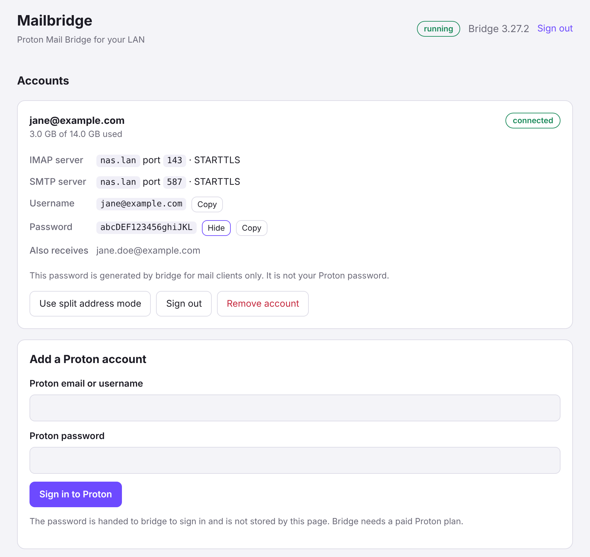

# Proton Mail Bridge for your LAN

A fork of [Proton Mail Bridge](https://github.com/ProtonMail/proton-bridge)
trimmed down to one job: run bridge headless in a Docker container, let any
IMAP/SMTP mail client on your LAN connect to it, and configure everything from
a web page served by the container.



## Quick start

```sh
docker run -d --name mailbridge --restart unless-stopped \
  -p 8080:8080 -p 143:143 -p 587:587 \
  -v mailbridge-data:/data \
  ghcr.io/avandeputte/proton-bridge:latest

docker logs mailbridge 2>&1 | grep -A3 "random one"
```

Then open `https://<your-server>:8080`, sign in with the password printed by
the second command, and add your Proton account. The page then shows the
server, port, username and password to enter in your mail client.

**Full instructions, configuration and security notes: [docker/README.md](docker/README.md).**

## What is in this repository

| Path | Contents |
|---|---|
| `docker/` | Dockerfile, compose example, and `mailbridge`: the supervisor, web UI and LAN port forwarder. |
| `.github/workflows/` | Builds the image for amd64 and arm64 and publishes it to `ghcr.io/avandeputte/proton-bridge`. |
| `cmd/Desktop-Bridge`, `internal/`, `pkg/` | Proton Mail Bridge itself, unmodified, minus the parts a headless Linux container never uses. |
| `Makefile` | `make build` builds the headless bridge binary, `make docker` builds the image. |

Removed compared to upstream: the Qt desktop GUI, the launcher, installers and
icons, Windows- and macOS-only code, Proton's CI configuration, the
integration test suite and developer utilities. The bridge code that remains
is unmodified upstream source, which keeps merging new upstream releases
straightforward: take upstream's version of every file that still exists here
and keep the deletions.

Based on Proton Mail Bridge 3.27.2. See [Changelog.md](Changelog.md) for
upstream's release history.

## License

GPLv3, see [LICENSE](LICENSE). Proton Mail Bridge is copyright Proton AG;
see [COPYING_NOTES.md](COPYING_NOTES.md) for third-party notices.
