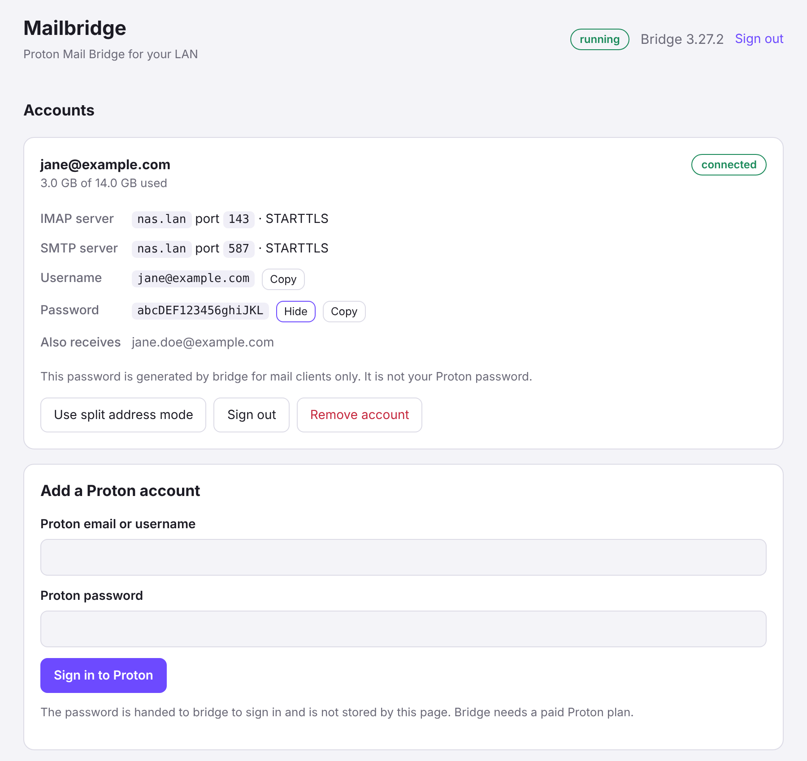

# Mailbridge: Proton Mail Bridge in a container, configured from a web page

This directory packages Proton Mail Bridge so it can run headless on a home
server and serve every mail client on your LAN over IMAP and SMTP. Everything
you would do in the desktop app (signing in to Proton, two-factor codes,
reading the bridge password, changing settings) is done from a web page served
by the container.

```
 mail clients ── IMAP 143 / SMTP 587 ──┐
                                       ├─ mailbridge ── gRPC ── bridge ── Proton
 your browser ──── HTTPS 8080 ─────────┘   (web UI, port forwarder, supervisor)
```



## Quick start

A ready-made image for amd64 and arm64 is published at
`ghcr.io/avandeputte/proton-bridge`. Save this as `docker-compose.yml` on your
server:

```yaml
services:
  mailbridge:
    image: ghcr.io/avandeputte/proton-bridge:latest
    container_name: mailbridge
    restart: unless-stopped
    ports:
      - "8080:8080"   # web UI (HTTPS, self-signed)
      - "143:143"     # IMAP (STARTTLS or SSL/TLS)
      - "587:587"     # SMTP (STARTTLS or SSL/TLS)
    volumes:
      - mailbridge-data:/data

volumes:
  mailbridge-data:
```

Then start it and read the web UI password that is generated on first start:

```sh
docker compose up -d
docker compose logs mailbridge | grep -A3 "random one"
```

[docker-compose.yml](docker-compose.yml) in this directory is the same thing
with the optional settings and container hardening spelled out. To build the
image yourself instead of pulling it, clone the repository and run
`docker compose -f docker/docker-compose.yml up -d --build`; compiling bridge
takes a few minutes.

1. Open `https://<your-server>:8080`. The certificate is self-signed, so the
   browser warns once; accept it.
2. Sign in with the generated password and change it under **Web UI password**.
3. Under **Add a Proton account**, sign in with your Proton email and password.
   The page asks for the two-factor code and the mailbox password if your
   account uses them. Bridge needs a paid Proton plan.
4. Wait for the first synchronisation to finish. The account card then shows
   the server, port, username and password to enter in your mail client.

## Mail client settings

| | Server | Port | Security | Username | Password |
|---|---|---|---|---|---|
| IMAP | your server's name or IP | 143 | STARTTLS or SSL/TLS | your Proton address | the **bridge password** from the web UI |
| SMTP | your server's name or IP | 587 | STARTTLS or SSL/TLS | your Proton address | the **bridge password** from the web UI |

The bridge password is generated by bridge. It is not your Proton password,
and it only works against this container.

Every mail port takes both kinds of encrypted session: a client that connects
and asks for STARTTLS, and a client that starts TLS right away (called
"SSL/TLS" or "implicit TLS", customary on ports 993 and 465). The container
tells them apart by who speaks first, so whichever of the two a mail client is
set to, or picks by itself, works.

Bridge encrypts both protocols with its own self-signed certificate, issued
for `127.0.0.1`. Mail clients will show a certificate warning the first time;
accept it, or download the certificate from **Maintenance** and import it if
your client wants it installed. (A client that starts TLS right away is
answered with the web UI's self-signed certificate instead, because bridge
only takes STARTTLS.) To get rid of the warnings altogether, give the
container [a certificate that mail clients trust](#a-certificate-that-mail-clients-and-browsers-trust-optional).

When a mail client turns the certificate down or sends a wrong password, the
web UI shows a notice saying which client and why. Mail clients themselves are
often vague about it.

### iPhone, iPad and Mac: set-up with a profile

Each account card has a button **Profile for iPhone, iPad and Mac**. It
downloads a configuration profile that sets the account up in Apple's Mail
app, with server, ports, username and bridge password filled in:

- **iPhone and iPad:** open the web UI in Safari, tap the button and allow the
  download. Then open the Settings app, tap *Profile Downloaded* near the top,
  and install it.
- **Mac:** download the profile and open it, then approve it in System
  Settings under *Profiles* (*Device Management* on recent versions).

Good to know:

- The profile contains the bridge password, like the page it comes from.
  Delete the downloaded file once it is installed, and do not send it around.
- It is not signed, so the device calls it "Not Signed" or "Unverified". That
  is expected.
- It is meant for a container with
  [a certificate that mail clients trust](#a-certificate-that-mail-clients-and-browsers-trust-optional).
  While installing, the device signs in to both servers to test the account,
  and it cannot ask you about a self-signed certificate at that point. A Mac
  then stops with "Profile installation failed. Unable to verify account name
  or password".
- The profile uses the server name and ports the account card shows. If they
  are wrong for your devices, correct them first under
  [Ports and addresses](#ports-and-addresses).
- An account in split mode gives one mail account per address.
- Installing a newer profile for the same account replaces the earlier one.
  Removing the profile removes the account from the device.

## A certificate that mail clients and browsers trust (optional)

Out of the box the web page and the mail ports use self-signed certificates,
and every browser and mail client asks you to accept them. With a domain name
of your own, the container can get a certificate from
[Let's Encrypt](https://letsencrypt.org/) and keep it renewed. The web page,
IMAP and SMTP then all present it, and nothing warns any more.

### Let's Encrypt

Let's Encrypt has to see proof that the domain is yours. A server on a home
LAN cannot be reached from the internet, so the proof is given through DNS:
the container briefly publishes a record in your domain, using an API token
from the company that hosts the domain's DNS. No port has to be opened to the
internet, now or at renewal.

You need:

1. **A domain name you own**, say `example.com`, with its DNS at a provider
   that has an API. Nearly 200 are supported, among them Cloudflare, Route 53,
   DigitalOcean, Hetzner, Gandi, OVH, Porkbun, Namecheap, GoDaddy, deSEC and
   DuckDNS.
2. **A name for the server in that domain**, say `mail.example.com`, that your
   devices resolve to the server's LAN address. An ordinary `A` record with the
   private address (such as `192.168.1.10`) at your DNS provider does it. Some
   routers refuse answers that point into the LAN ("DNS rebind protection");
   in that case add the name to the router's or Pi-hole's local DNS instead.
3. **An API token from the DNS provider**, limited to editing DNS records of
   that one domain if the provider lets you.

Then, in the web UI, press **Get a certificate from Let's Encrypt** in the
**Certificate** card. Enter the name, pick the DNS provider, and the form asks
for what that provider needs, such as the API token. Press **Save and request
the certificate**. The settings are kept in the volume, and the token is never
sent back to the page: when you open the form again it only says that a value
is saved.

The same can be set in the compose file instead, here for Cloudflare:

```yaml
    environment:
      MAILBRIDGE_ACME_DOMAINS: "mail.example.com"
      MAILBRIDGE_ACME_DNS: "cloudflare"
      CLOUDFLARE_DNS_API_TOKEN: "your-token"
```

Settings from the compose file win: the form in the web UI is then switched
off, and the container has to be recreated for a change.

`MAILBRIDGE_ACME_DNS`, like the provider field of the form, is the provider's
code, and each provider reads its credentials from variables of its own. The
work is done by [lego](https://go-acme.github.io/lego/), which is included in
the image; its [list of DNS providers](https://go-acme.github.io/lego/dns/) has
the code and the variables for every one. A few common ones:

| Provider | `MAILBRIDGE_ACME_DNS` | Credentials |
|---|---|---|
| Cloudflare | `cloudflare` | `CLOUDFLARE_DNS_API_TOKEN` (permission *Zone / DNS / Edit* on the zone) |
| Amazon Route 53 | `route53` | `AWS_ACCESS_KEY_ID`, `AWS_SECRET_ACCESS_KEY`, `AWS_REGION` |
| DigitalOcean | `digitalocean` | `DO_AUTH_TOKEN` |
| Hetzner | `hetzner` | `HETZNER_API_TOKEN` |
| Gandi | `gandiv5` | `GANDIV5_PERSONAL_ACCESS_TOKEN` |
| Porkbun | `porkbun` | `PORKBUN_API_KEY`, `PORKBUN_SECRET_API_KEY` |
| Namecheap | `namecheap` | `NAMECHEAP_API_USER`, `NAMECHEAP_API_KEY` |
| GoDaddy | `godaddy` | `GODADDY_API_KEY`, `GODADDY_API_SECRET` |
| deSEC | `desec` | `DESEC_TOKEN` |
| DuckDNS | `duckdns` | `DUCKDNS_TOKEN` |

`docker compose exec mailbridge lego dnshelp -c cloudflare` prints the same
information for the version in the image. Most providers also accept the
variable name with `_FILE` appended, naming a file to read the secret from
(Docker secrets).

The **Certificate** card in the web UI shows the request in progress, which
usually takes a minute or two, and from then on which certificate is in use
and until when. The web page, IMAP and SMTP switch to it as soon as it is
there, without a restart. Until it arrives, and whenever a request fails, the
self-signed certificate stays in use and the card shows what the DNS provider
or Let's Encrypt complained about. Open the web UI as
`https://mail.example.com:8080` and enter `mail.example.com` as the server in
your mail clients: a certificate is only good for the names it was issued for,
so connecting by IP address still warns.

Good to know:

- **Try it in test mode first.** Let's Encrypt allows only a few failed
  attempts per hour and a limited number of certificates per week. With
  **Test mode** ticked in the form, or `MAILBRIDGE_ACME_SERVER: "staging"` in
  the compose file, you get test certificates (which clients do not trust)
  from a server with generous limits. Turn it off once the Certificate card
  shows one, and the real certificate is requested.
- **Renewal is automatic.** The container checks twice a day and renews when a
  third of the lifetime is left, without a restart and without interrupting
  open mail sessions. The DNS token therefore has to stay valid.
- **Several names and wildcards** work: `"mail.example.com,*.home.example.com"`.
  When you change the list, the certificate is replaced: right away from the
  web UI, at the next start from the compose file.
- **The certificate and the Let's Encrypt account** are kept in the volume,
  under `/data/mailbridge/acme`, and what you entered in the web UI in
  `/data/mailbridge/acme.json`.
- **Turn off Let's Encrypt** in the form goes back to the self-signed
  certificate and forgets the token.
- If your LAN has a DNS server of its own that answers for the whole domain,
  lego cannot find the real name servers through it. Point it at a public
  resolver: `1.1.1.1:53` under **Advanced** in the form, or
  `MAILBRIDGE_ACME_RESOLVERS: "1.1.1.1:53"`.
- Other certificate authorities that speak ACME work too: put their directory
  URL in `MAILBRIDGE_ACME_SERVER`.

### Your own certificate

If you already have a certificate, from another ACME client or your own CA,
mount it and name the files:

```yaml
    volumes:
      - mailbridge-data:/data
      - /etc/letsencrypt/live/mail.example.com:/certs:ro
    environment:
      MAILBRIDGE_TLS_CERT: "/certs/fullchain.pem"
      MAILBRIDGE_TLS_KEY: "/certs/privkey.pem"
```

The files have to be readable by `PUID`. When they change, because the other
tool renewed the certificate, the container picks the new one up within a
minute, without a restart.

### What changes for mail clients

Bridge can only ever present its own self-signed certificate. So with a
Let's Encrypt certificate or one of your own, the container answers SMTP (and
IMAP, unless Dovecot does) itself, with that certificate, and passes each
session on to bridge over a second encrypted connection inside the container,
on which it only accepts bridge's own certificate. It starts doing so the
moment the certificate is there, for new sessions. Ports, security setting and
passwords in the mail client stay the same; a client that had accepted
bridge's certificate before will notice the new one once. The server to enter
is a name on the certificate, and the account card shows that name from then
on.

One thing is stricter than bridge on its own: signing in before encryption has
started is refused. Every current mail client starts encryption first anyway.

## Ports and addresses

Under **Settings**, the web UI has two groups of fields for where mail clients
and browsers find the container. Both take effect when you save, without a
restart, and are kept in the volume.

### Other port numbers

**Ports this container listens on** opens IMAP, SMTP or, in Dovecot mode, IMAP
with SSL/TLS on a port of your choice. The port is opened in addition to the
one from the compose file (143, 587), so nothing that works stops working, and
the account card and the profiles show the new one from then on.

How the new port reaches your LAN depends on how the container is attached:

- With `network_mode: host`, it is simply there.
- With published ports, publish it too and recreate the container, for
  example `- "2143:2143"`. If all you want is another number on the host, you
  can leave the container alone, publish `"2143:143"`, and enter 2143 under
  *Addresses that browsers and mail clients use* instead.

The port of the web UI itself is not changed from the page: publish it under
another number (`"9443:8080"`), or set `MAILBRIDGE_WEB_LISTEN`.

### Behind a reverse proxy

**Addresses that browsers and mail clients use** is for everything that sits
between your devices and the container. Nothing there opens or closes a port:
the fields say what the page shows, what goes into profiles, and where the
page itself is found.

**The web UI behind an HTTP reverse proxy.** Enter the address the proxy
serves it at under *Address of this page*, such as `https://mail.example.com`
or, on a sub-path, `https://example.com/mailbridge`. The same can be given as
`MAILBRIDGE_PUBLIC_URL`; the field in the web UI wins if both are set.

- On a sub-path, the proxy may pass the path on as it is or cut the prefix
  off: both work. The page also keeps working at the container's own address,
  so a mistake can always be put right there. For the same reason the path
  cannot be changed from behind a proxy that passes it on.
- The container serves HTTPS with its own certificate. Either tell the proxy
  not to verify it (nginx does not by default; Caddy needs
  `tls_insecure_skip_verify`, Traefik `insecureSkipVerify`), or set
  `MAILBRIDGE_TLS: "off"` and proxy to plain HTTP, on a network only the
  proxy can reach.
- A proxy on the internet puts the sign-in page on the internet. See
  [Security](#security).

For example with nginx, on a sub-path:

```nginx
location /mailbridge/ {
    proxy_pass https://192.168.1.10:8080;
    proxy_set_header X-Forwarded-For $remote_addr;
}
```

or with Caddy, on a name of its own:

```
mail.example.com {
    reverse_proxy https://192.168.1.10:8080 {
        transport http {
            tls_insecure_skip_verify
        }
    }
}
```

**IMAP and SMTP behind a TCP proxy** (nginx `stream`, HAProxy in `tcp` mode,
Traefik TCP routers, a port forward on a router). Enter the name and the ports
that mail clients connect to under *Mail server name*, *IMAP port* and *SMTP
port*. The account card and the profiles then show those, whatever the
container itself listens on.

- **Pass the connection through unchanged.** The container does the
  encryption itself and needs to see the session from its first byte. A proxy
  cannot end STARTTLS on the container's behalf.
- **Any port to any port.** Each mail port of the container takes STARTTLS
  and SSL/TLS, so 993 or 465 on the proxy can go to 143 or 587 in the
  container as well as 143 and 587 can.
- **The certificate is still the container's.** For clients to trust it, the
  certificate has to be good for the name they connect to, the proxy's. With
  [Let's Encrypt](#lets-encrypt) that is the name to ask the certificate for;
  nothing about the proxy has to change, since the proof goes through DNS.
- **Routing by server name (SNI)** only works for sessions that start with
  TLS. Set the mail clients to SSL/TLS, not STARTTLS, for ports that the
  proxy routes that way.
- **Turn the PROXY protocol off** for these backends (`send-proxy` in HAProxy,
  `proxy_protocol on` in nginx). The container does not expect that header and
  the session would fail.
- Every client then appears to come from the proxy's address, in the log and
  to the limits on wrong passwords.

For example with nginx:

```nginx
stream {
    server { listen 143; proxy_pass 192.168.1.10:143; }
    server { listen 993; proxy_pass 192.168.1.10:143; }
    server { listen 587; proxy_pass 192.168.1.10:587; }
}
```

`MAILBRIDGE_HOSTNAME`, `MAILBRIDGE_IMAP_PORT`, `MAILBRIDGE_SMTP_PORT` and
`MAILBRIDGE_IMAPS_PORT` set the same server name and ports from the compose
file. A field filled in on the page wins over them.

## Dovecot mode: full-text search and a standard IMAP server (optional)

Bridge's built-in IMAP server is deliberately small. Searching message text
scans every message, undecoded, and many IMAP extensions that mail clients
like are missing. With `MAILBRIDGE_DOVECOT=on` the container also runs
[Dovecot](https://www.dovecot.org/), and mail clients talk to Dovecot instead:

```
 mail clients ── IMAP ── Dovecot ══ two-way sync ══ bridge ── Proton
 mail clients ── SMTP ───────────────────────────── bridge ── Proton
```

What you get:

- **Fast full-text search.** Every message is indexed as it arrives, on its
  decoded text, so a search finds words in encoded bodies and is answered from
  the index instead of by reading the whole mailbox.
- **A complete IMAP server**: server-side sorting and threading, quick
  resynchronisation (CONDSTORE, QRESYNC), special-use folders, and the rest of
  what Dovecot offers.

What it costs:

- **A second copy of your mail** in the volume, as ordinary Maildir files, plus
  the search index. Plan for a bit more than the size of the mailbox on top of
  bridge's own cache. Unlike bridge's cache the files are not encrypted, though
  the key to bridge's cache sits in the same volume anyway.
- **Changes take a moment to travel**, see the timings below, and the first
  copy of a large mailbox can take hours.

Sending is unchanged: SMTP still goes straight to bridge.

### Turning it on

```yaml
    ports:
      - "8080:8080"
      - "143:143"     # IMAP (STARTTLS or SSL/TLS), now served by Dovecot
      - "993:993"     # IMAP on its customary SSL/TLS port, optional
      - "587:587"
    environment:
      MAILBRIDGE_DOVECOT: "on"
      MAILBRIDGE_IMAPS_LISTEN: ":993"   # optional
```

Recreate the container (`docker compose up -d`). Each account card in the web
UI gets a **Dovecot copy** line that shows the state of the sync. Mail clients
can connect as soon as it says *in sync*.

Mail client settings stay the same: same server, same username, same bridge
password, port 143 (or 993), with STARTTLS or SSL/TLS. Two things differ:

- IMAP presents the certificate of the web UI, not bridge's. SMTP still
  presents bridge's, unless you set up
  [a trusted certificate](#a-certificate-that-mail-clients-and-browsers-trust-optional),
  which all three then share.
- To a mail client, this is a different server than bridge was. A client that
  was already set up downloads the mailbox again after you switch, in either
  direction.

If sent messages show up twice, turn off "save a copy of sent messages" in the
mail client: Proton files everything sent through bridge in Sent by itself.

### How the sync behaves

| Change | Reaches the other side |
|---|---|
| Anything done in a mail client (read, flag, move, delete, file, new folder) | within about 5 seconds |
| New mail in INBOX and Sent | within about 15 seconds |
| Anything else changed on Proton's side (web, phone, filters) | within 5 minutes, or right away with **Sync now** |

- Messages, read/starred/answered state, moves, deletions and folders travel
  in both directions. A move in a mail client is a move on Proton, not a
  re-upload.
- `All Mail` is left out, because it holds every message a second time, and so
  is `Starred`: stars travel as the flag on the message.
- `Labels/...` folders hold a copy of each labelled message, as they do in
  bridge.
- New folders have to be created under `Folders/` or `Labels/`; Proton has no
  other place for them. Renaming folders and deleting folders that still hold
  mail is best done in Proton, and shows up in Dovecot at the next sync.
- Messages that a client only marks as deleted are removed at the next sync,
  as if the client had expunged them.

### The deletion guard

Deleting in Dovecot deletes on Proton, so a mail client gone wrong or a damaged
volume could empty your mailbox. To prevent that, the sync pauses when more
than 100 messages (`MAILBRIDGE_SYNC_MAX_DELETE`) were removed for good from
Dovecot within an hour, and the web UI asks you what to do:

- **Restore them from Proton** throws the Dovecot copy away and downloads the
  mailbox again. Nothing is changed on Proton.
- **Remove them from Proton too** lets the sync continue.

Moving mail to Trash or Spam and emptying those does not count, only mail that
disappears from the other folders does. Deletions made on Proton's side are
always followed.

**Rebuild from Proton** is also available at any time. It is the way out if
the two sides ever disagree, for example after *Repair local cache*.

### Limits

This mode has been tested against bridge's IMAP engine (Gluon) and a second
Dovecot standing in for Proton, not yet against a live Proton account. Keep an
eye on the first days, and leave the deletion guard on.

The container has to start as root (the default) so that it can prepare the
user Dovecot runs as; `PUID`/`PGID` work, `docker run --user` does not.

Turning the mode off again leaves the copy in `/data/dovecot`. Delete that
directory to free the space.

## Configuration

None of these environment variables is required. The Let's Encrypt
certificate, extra ports and the addresses shown to clients can also be set
in the web UI, which keeps them in the volume.

| Variable | Default | Meaning |
|---|---|---|
| `MAILBRIDGE_PASSWORD` | generated | Fixed web UI password. When set it cannot be changed from the page. |
| `MAILBRIDGE_PASSWORD_FILE` | | Same, read from a file (Docker secrets). |
| `MAILBRIDGE_HOSTNAME` | automatic | Server name shown in the mail client settings and written into profiles. Left out, it is the first name on a trusted certificate, else the host of the public URL, else the name your browser used. *Mail server name* in the web UI wins. |
| `MAILBRIDGE_PUBLIC_URL` | | Address of the web UI [behind a reverse proxy](#behind-a-reverse-proxy), such as `https://example.com/mailbridge`. *Address of this page* in the web UI wins. |
| `MAILBRIDGE_TLS` | `on` | `off` serves the web UI over plain HTTP, for use behind a TLS-terminating reverse proxy only. |
| `MAILBRIDGE_TLS_CERT`, `MAILBRIDGE_TLS_KEY` | self-signed | Your own certificate (with its chain) and key, as PEM files, for the web UI, IMAP and SMTP. See [above](#your-own-certificate). |
| `MAILBRIDGE_WEB_LISTEN` | `:8080` | Address the web UI listens on inside the container. |
| `MAILBRIDGE_IMAP_LISTEN` | `:143` | Address(es) forwarded to bridge IMAP, comma separated. `off` disables. |
| `MAILBRIDGE_SMTP_LISTEN` | `:587` | Address(es) forwarded to bridge SMTP, comma separated. `off` disables. |
| `MAILBRIDGE_IMAP_PORT`, `MAILBRIDGE_SMTP_PORT` | listen port | Port numbers shown in the web UI and written into profiles, if clients use other ports than the container listens on. The ports under *Addresses that browsers and mail clients use* in the web UI win. |
| `PUID`, `PGID` | `1000` | User and group that own `/data` and run bridge. |
| `BRIDGE_LOG_LEVEL` | `info` | Bridge log level (`debug`, `info`, `warn`, `error`). |

For a [Let's Encrypt certificate](#lets-encrypt), instead of the form in the
web UI. With `MAILBRIDGE_ACME_DOMAINS` set, the form is switched off; the
other variables also apply to a certificate set up in the form, as defaults:

| Variable | Default | Meaning |
|---|---|---|
| `MAILBRIDGE_ACME_DOMAINS` | | Name(s) to get the certificate for, comma separated. |
| `MAILBRIDGE_ACME_DNS` | | lego's code for the DNS provider of the domain, such as `cloudflare`. The provider's own variables (`CLOUDFLARE_DNS_API_TOKEN`, ...) carry the credentials. |
| `MAILBRIDGE_ACME_EMAIL` | | Optional contact address for the Let's Encrypt account. |
| `MAILBRIDGE_ACME_SERVER` | Let's Encrypt | `staging` for Let's Encrypt's test server, or the directory URL of another ACME certificate authority. |
| `MAILBRIDGE_ACME_RESOLVERS` | system | DNS resolver(s) lego uses to find the domain's name servers, such as `1.1.1.1:53`. |
| `MAILBRIDGE_ACME_LEGO_ARGS` | | Further [options for lego](https://go-acme.github.io/lego/usage/cli/options/), such as `--dns.propagation-wait 2m` for a DNS provider that is slow to publish. |

For [Dovecot mode](#dovecot-mode-full-text-search-and-a-standard-imap-server-optional):

| Variable | Default | Meaning |
|---|---|---|
| `MAILBRIDGE_DOVECOT` | `off` | `on` puts Dovecot between mail clients and bridge. |
| `MAILBRIDGE_IMAPS_LISTEN` | | Address(es) for a second IMAP port, such as `:993`, where clients expect SSL/TLS by default. |
| `MAILBRIDGE_IMAPS_PORT` | listen port | Port number shown in the web UI, if you publish a different host port. |
| `MAILBRIDGE_MAIL_DIR` | `/data/dovecot` | Where Dovecot keeps mail and search indexes. Another volume works if `PUID` can write to it. |
| `MAILBRIDGE_SYNC_FOLDERS` | `INBOX,Sent` | Folders checked for changes on Proton's side every `MAILBRIDGE_SYNC_INTERVAL`. |
| `MAILBRIDGE_SYNC_INTERVAL` | `15s` | How often those folders are checked. |
| `MAILBRIDGE_SYNC_FULL_INTERVAL` | `5m` | How often all folders are checked. |
| `MAILBRIDGE_SYNC_EXCLUDE` | `All Mail,Starred` | Folders that are not copied. `*` and `%` work as in IMAP. |
| `MAILBRIDGE_SYNC_MAX_DELETE` | `100` | Removals per hour beyond which the sync waits for your confirmation. |
| `MAILBRIDGE_SYNC_DEBUG` | `off` | `on` writes what the sync does to the container log. |

All state lives in the `/data` volume: the Proton session, the encrypted mail
cache, the keychain, the web UI password hash, the certificates and what was
set in the web UI (`acme.json`, `ports.json` and `public.json` in
`/data/mailbridge`; delete one and restart to go back to the defaults). Back it up
or lose it as one unit; if it is lost, sign in again and bridge re-downloads
your mail.

## Security

Treat this container like the mail account itself.

- **The web UI is password protected** because it shows the bridge passwords
  and accepts your Proton password. Sign-in attempts are throttled, sessions
  expire after 12 hours, and the page is served over HTTPS by default.
- **Keep it on the LAN.** Do not publish ports 8080, 143, 993 or 587 to the
  internet, and think twice before putting a reverse proxy that faces the
  internet in front of them: the web UI password is then all that stands
  between the internet and your mail. For remote access use a VPN.
- **The DNS token for Let's Encrypt can change your domain's DNS.** Create one
  that is limited to DNS records of the one domain. Entered in the web UI, it
  is stored in the volume, in a file only the container's user can read, and
  never shown again. In the compose file, prefer the `_FILE` form of the
  variable.
- **A profile for Apple devices contains the bridge password.** Delete the
  downloaded file after installing it.
- **The volume holds the keys.** Bridge stores the key to its vault in a
  `pass` keychain whose GPG key has no passphrase (there is nobody to type one
  when the container starts). Anyone who can read the volume can read the
  account's credentials and cached mail.
- Your Proton password is passed to bridge to sign in and is never written to
  disk by the web UI.
- Bridge and the web UI run as an unprivileged user with no capabilities.
- Security-key (FIDO2) two-factor is not available in a container. Accounts
  that only have a security key need an authenticator app added first.

## Updating

Bridge cannot update itself inside the image, so automatic updates are turned
off. To update, pull the newer image and recreate the container:

```sh
docker compose pull
docker compose up -d
```

`:latest` follows the `master` branch. Images are also tagged with the bridge
version they contain (for example `:3.27.2`) and with the commit they were
built from, if you prefer to pin. If you build the image yourself, `git pull`
and run `up -d --build` again.

Proton occasionally retires old bridge versions. The web UI shows a notice
when that happens.

## Troubleshooting

- **Mail client cannot connect at all.** Bridge only opens IMAP and SMTP once
  at least one account is signed in. Check the account card says "connected".
- **Mail client says wrong password.** Use the bridge password from the
  account card, not the Proton password. The web UI shows a notice when a
  client tries a wrong one.
- **"Open Proton verification" during sign-in.** Proton wants a CAPTCHA.
  Complete it in the tab that opens, then press *I completed the
  verification*.
- **Lost the web UI password.** Delete `webui.json` from the volume and
  restart; a new one is printed in the log:
  `docker compose exec mailbridge rm /data/mailbridge/webui.json`
- **Something is stuck.** *Show bridge log* in the web UI, or
  `docker compose logs -f mailbridge`.
- **Dovecot copy says "problem".** The line below it is what the sync
  complained about; the rest of the mailbox keeps synchronising. A folder
  created outside `Folders/` and `Labels/` is the usual cause: move it there.
  If the two sides no longer line up, use *Rebuild from Proton*.
- **The Let's Encrypt certificate does not arrive.** The Certificate card and
  the container log (lines starting with `[lego]`) say why. The usual causes
  are a token without permission to edit the domain's DNS, a domain that is
  hosted at another provider than the one named, and a local DNS server that
  answers for the whole domain (set a DNS resolver under **Advanced** in the
  form, or `MAILBRIDGE_ACME_RESOLVERS`). After a failure the container waits
  15 minutes, then longer each time, to stay within Let's Encrypt's limits;
  **Try again now** in the Certificate card skips the wait.
- **"Profile installation failed. Unable to verify account name or
  password" on a Mac.** While installing a profile, the Mac signs in to IMAP
  and SMTP, and this is all it says when either fails. Look at the notices at
  the top of the web UI and at `docker compose logs mailbridge` right after
  an attempt. The usual causes are a certificate the Mac does not trust (get
  one from Let's Encrypt, and check that *Mail server name* is a name on it),
  and a server name or port in the account card that the Mac cannot reach.
- **Still a certificate warning with a trusted certificate.** The client is
  connecting by IP address or by another name than the certificate was issued
  for. Use the name on the Certificate card.
- **The page says "unreachable" in a window that was open before the
  certificate changed.** A browser accepts a self-signed certificate for the
  one address and the one certificate you confirmed. Once the container has
  a certificate from Let's Encrypt, a window still open at the old address is
  refused by its own browser and keeps trying every few seconds. Close it and
  open the page by a name on the certificate. The web UI shows a notice
  naming the browser's address and the address it asked for, and the log has
  a line `web UI: ...` about it every 15 minutes at most.
- **A port set in the web UI cannot be opened.** Something else in the
  container's network uses it. With `network_mode: host` that includes
  everything else on the server, and ports below 1024 are usually off limits
  there for the unprivileged user the container runs as. The page says so
  when you save, and shows a notice if it happens at start.
- **The page does not load behind a reverse proxy on a sub-path.** If the
  proxy passes the path on unchanged, the container has to know the path:
  open the page at its own address and fill in *Address of this page*, or set
  `MAILBRIDGE_PUBLIC_URL`.
- **Bind-mounting `/data`.** Use a local filesystem. GnuPG needs Unix sockets,
  which most network shares do not support.

## How it works

`docker/mailbridge` is a small Go program that is the container's main
process. It

- starts `bridge --grpc` and restarts it if it exits,
- talks to bridge over the same gRPC API the official desktop GUI uses (the
  client code is generated from this repository's `bridge.proto` at image
  build time, so it always matches the bridge it ships with),
- serves the web UI, and
- forwards the LAN-facing IMAP and SMTP ports to bridge, which itself only
  ever listens on `127.0.0.1`. The forwarding is byte-for-byte, so TLS is
  still end-to-end between the mail client and bridge. While it has a
  [trusted certificate](#what-changes-for-mail-clients), and for a client
  that starts TLS in the other way than bridge expects, it ends TLS itself
  instead and opens a second TLS session to bridge.

In Dovecot mode it also runs Dovecot, forwards the LAN-facing IMAP ports to it
instead, and runs [mbsync](https://isync.sourceforge.io/) between Dovecot and
bridge whenever something changed in Dovecot and on a timer. Dovecot accepts
the same usernames and bridge passwords as bridge does.

Bridge itself is built unmodified from this source tree.

## License

GPLv3, like Proton Mail Bridge. See [LICENSE](../LICENSE).
